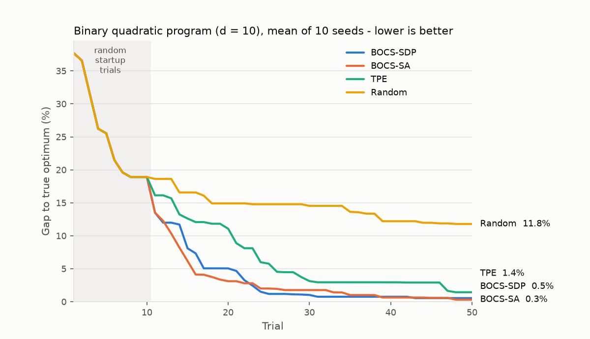

## Abstract

This package implements BOCS (Baptista & Poloczek, ICML 2018) for Optuna. BOCS optimizes expensive black-box functions over binary decisions, for example which features, components or assets to include.

In each trial, BOCS:

1. fits a second-order model of the objective, `f(x) = a_0 + sum_j a_j x_j + sum_{i<j} a_ij x_i x_j`, whose coefficients have a sparsity-inducing horseshoe prior, sampled with a Gibbs sampler;
1. draws one coefficient vector from the posterior (Thompson sampling);
1. proposes the binary point that maximizes it. The resulting binary quadratic program is NP-hard, so it is solved approximately, either with a semidefinite relaxation and randomized rounding (BOCS-SDP) or with simulated annealing (BOCS-SA).

On the binary quadratic programming benchmark of the paper, BOCS gets closer to the optimum than TPE and random search with the same budget:



| Sampler  | Gap after 25 trials | Gap after 50 trials | Optimum found (50 trials) | Time per trial |
| -------- | ------------------: | ------------------: | ------------------------: | -------------: |
| BOCS-SDP |                1.2% |                0.6% |                    7 / 10 |         0.04 s |
| BOCS-SA  |                2.0% |                0.3% |                    9 / 10 |         0.03 s |
| TPE      |                5.8% |                1.4% |                    6 / 10 |         0.01 s |
| Random   |               14.8% |               11.8% |                    1 / 10 |       < 0.01 s |

The gap is `(f* - best value found) / (f* - f_min)`, averaged over 10 random instances with d = 10 binary variables (correlation length 10, as in Sect. 4.1 of the paper), where `f*` and `f_min` are found by enumerating all 1024 points.

## APIs

- `BOCSSampler(*, acquisition: Literal["sdp", "sa"] = "sdp", n_startup_trials: int = 10, penalty: float = 0.0, n_burnin: int = 1000, n_gibbs_steps: int = 100, n_rounding: int = 100, seed: int | None = None, independent_sampler: BaseSampler | None = None, warn_independent_sampling: bool = True)`
  - `acquisition`: `"sdp"` maximizes the sampled model with a semidefinite relaxation and randomized rounding; `"sa"` uses simulated annealing, which is cheaper when there are many binary parameters.
  - `n_startup_trials`: Number of initial trials sampled by `independent_sampler`.
  - `penalty`: Weight `lambda` of the regularizer `lambda * sum(x)` from the paper, in units of the standardized objective. A positive value favors points with fewer ones.
  - `n_burnin`: Number of Gibbs sweeps before the first posterior sample.
  - `n_gibbs_steps`: Number of Gibbs sweeps per trial afterwards. The Gibbs chain is warm-started from the previous trial.
  - `n_rounding`: Number of randomized roundings per rounding method (only for `"sdp"`).
  - `seed`: Seed for the random number generator.
  - `independent_sampler`: Sampler for the startup trials and for non-binary parameters. Defaults to `RandomSampler` with the same seed.
  - `warn_independent_sampling`: Whether to warn when a non-binary parameter is sampled by `independent_sampler` after the startup trials.

Binary parameters are declared with `trial.suggest_int(name, 0, 1)` or with a two-choice `trial.suggest_categorical(name, [a, b])`. Other parameters are sampled by `independent_sampler`. Multi-objective optimization is not supported.

## Installation

```shell
pip install -r https://hub.optuna.org/samplers/bocs/requirements.txt
```

BOCS-SDP solves the semidefinite program with [CVXPY](https://www.cvxpy.org/) and its default open-source solver, Clarabel.

## Example

```python
import numpy as np
import optuna
import optunahub


rng = np.random.default_rng(0)
Q = rng.normal(size=(10, 10))


def objective(trial: optuna.Trial) -> float:
    x = np.array([trial.suggest_int(f"x{i}", 0, 1) for i in range(10)])
    return float(x @ Q @ x)


sampler = optunahub.load_module("samplers/bocs").BOCSSampler(seed=0)
study = optuna.create_study(direction="maximize", sampler=sampler)
study.optimize(objective, n_trials=50)
print(study.best_params, study.best_value)
```

## Others

### Implementation notes

- **Coefficient sampling.** The Gaussian full conditional of the coefficients is sampled with the algorithm of Bhattacharya et al. (2016), which solves an N-by-N system and is fast when there are fewer trials than coefficients. Once there are more trials than coefficients, a p-by-p Cholesky factorization is used instead. The Gibbs sampler is validated with a Geweke (2004) "getting it right" test.
- **Rounding.** The paper uses the randomized rounding of Charikar & Wirth (2004). This implementation applies both that rounding and random hyperplane rounding (Goemans & Williamson, 1995) and keeps the best point, which keeps the worst-case guarantee of the former. On random second-order models with d = 12, hyperplane rounding found the exact optimum of the acquisition on 97% of instances versus 43% for Charikar–Wirth alone.
- **Simulated annealing.** The paper refers to the schedule of Spears (1993) without constants. Here SA proposes `10 d^2` single-bit flips and cools geometrically from the mean absolute single-flip change at the start point down to 1/1000 of it.
- **Objective scaling.** Objective values are standardized before fitting, and the sign is flipped for minimization.

### Reference

Ricardo Baptista and Matthias Poloczek. Bayesian Optimization of Combinatorial Structures. In Proceedings of the 35th International Conference on Machine Learning (ICML), 2018.

### Bibtex

```bibtex
@inproceedings{baptista2018bocs,
  title={Bayesian Optimization of Combinatorial Structures},
  author={Baptista, Ricardo and Poloczek, Matthias},
  booktitle={Proceedings of the 35th International Conference on Machine Learning},
  pages={462--471},
  year={2018}
}
```
